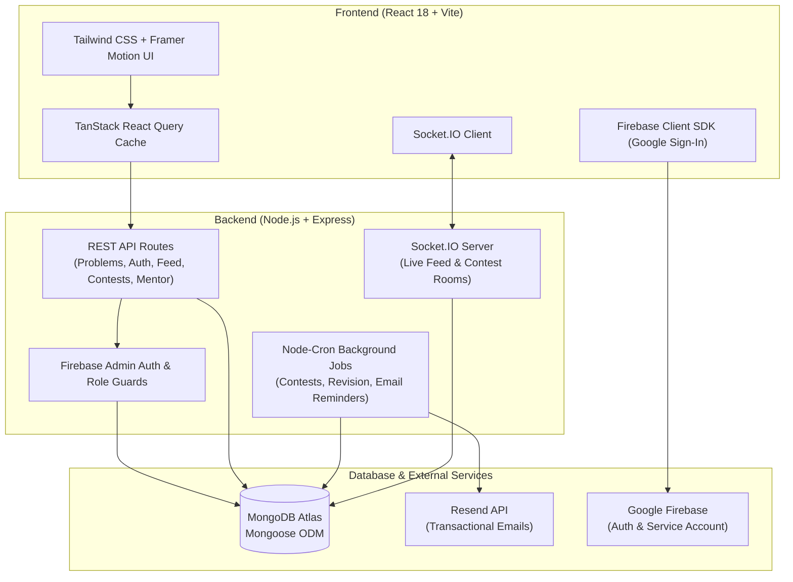

# DSAMASTER 🚀

> **Comprehensive Data Structures & Algorithms learning, competitive programming tracking, real-time leaderboard, and spaced-repetition revision platform.**

DSAMASTER is a full-stack platform built for competitive programmers and interview candidates to solve curated DSA problems (NeetCode 150 / Striver patterns), track real-time study streaks, participate in automated scheduled contests, and engage with peer mentors.

---

## 🏗️ System Architecture



---

## ✨ Key Features & Capabilities

- **Curated Problem Tracking**: Comprehensive NeetCode and Striver problem seeders with difficulty tagging, category filters, and completion status.
- **Real-Time Contests & Leaderboards**: WebSocket-driven contest rooms with dynamic time synchronization and live XP scoring.
- **Spaced Repetition & Revision System**: Automated `node-cron` jobs computing retention intervals to notify users when problem re-solving is recommended.
- **Mentorship & Community Forum**: Role-based access control (Admin, Mentor, Student) allowing mentor notes, feedback loops, and discussion threads.
- **Gamification & Analytics**: Daily streak tracking, milestone achievement badges, XP progression, and Recharts activity heatmaps.

---

## 🛠️ Tech Stack

| Tier | Technologies |
| :--- | :--- |
| **Frontend** | React 18, Vite, Tailwind CSS, Framer Motion, TanStack Query v5, Recharts, Lucide Icons |
| **Backend** | Node.js (v18+), Express 4, Socket.IO, `node-cron`, `helmet`, `express-rate-limit`, Zod |
| **Database** | MongoDB Atlas, Mongoose ODM |
| **Authentication** | Firebase Authentication (Google OAuth + JWT verification via `firebase-admin`) |
| **Email Service** | Resend API (digest updates, revision triggers) |
| **Deployment** | Vercel (Frontend Client) + Render (Backend Web Service) |

---

## 📁 Repository Structure

```
DsaMaster/
├── client/                      # Production React 18 + Vite frontend
│   ├── src/
│   │   ├── components/          # Reusable UI cards, tables, modals
│   │   ├── context/             # Auth and global state providers
│   │   ├── hooks/               # Custom React hooks
│   │   ├── pages/               # Contest, Problems, Leaderboard, Forum pages
│   │   └── services/            # Axios API clients
│   ├── .env.example             # Frontend environment template
│   └── package.json
├── server/                      # Node.js + Express backend service
│   ├── config/                  # DB, Firebase Admin, and Socket.IO initialization
│   ├── jobs/                    # Node-cron background tasks (contests, revision, emails)
│   ├── middleware/              # Auth verification, rate limiting, and role guards
│   ├── models/                  # Mongoose schemas (User, Problem, Contest, Forum, etc.)
│   ├── routes/                  # Express REST controllers
│   ├── seeders/                 # Seed scripts for curated problem collections
│   ├── services/                # Business logic (XP, streaks, notifications, emails)
│   ├── .env.example             # Backend environment template
│   └── server.js                # HTTP server and WebSocket entry point
├── render.yaml                  # Infrastructure-as-code for Render deployment
└── README.md
```

---

## 🚀 Getting Started

### Prerequisites

- **Node.js**: v18.0.0 or higher
- **MongoDB**: MongoDB Atlas connection string (or local MongoDB 6+)
- **Firebase Project**: Firebase console project with Google Authentication enabled and service account credentials
- **Resend**: API key for transactional emails

---

### Step 1: Clone the Repository

```bash
git clone https://github.com/Narasimhamanam/DsaMaster.git
cd DsaMaster
```

---

### Step 2: Configure & Launch Backend Server

```bash
cd server

# Create local environment config
cp .env.example .env
```

Populate the required environment variables in `server/.env`:

| Variable | Description |
| :--- | :--- |
| `PORT` | Backend listening port (default: `5000`) |
| `MONGODB_URI` | MongoDB Atlas URI string |
| `JWT_SECRET` | Secret token for session signing |
| `FIREBASE_*` | Firebase project credentials / service account config |
| `RESEND_API_KEY` | Transactional email API key |
| `CLIENT_URL` | Allowed CORS origin (default: `http://localhost:5173`) |

```bash
# Install dependencies
npm install

# Seed the curated problem dataset into MongoDB
npm run seed

# Run server in development mode
npm run dev
```

The backend server will start on `http://localhost:5000`.

---

### Step 3: Configure & Launch Frontend Client

In a separate terminal:

```bash
cd client

# Create local environment config
cp .env.example .env
```

Populate the required environment variables in `client/.env`:

| Variable | Description |
| :--- | :--- |
| `VITE_API_BASE_URL` | Backend REST URL (e.g., `http://localhost:5000/api`) |
| `VITE_SOCKET_URL` | Backend WebSocket URL (e.g., `http://localhost:5000`) |
| `VITE_FIREBASE_API_KEY` | Firebase Web API key |
| `VITE_FIREBASE_AUTH_DOMAIN` | Firebase Web Auth domain |
| `VITE_FIREBASE_PROJECT_ID` | Firebase project identifier |

```bash
# Install dependencies
npm install

# Run frontend development server
npm run dev
```

Open [http://localhost:5173](http://localhost:5173) in your browser.

---

## 🌐 Production Deployment

- **Frontend (Vercel)**: Point Vercel root directory to `client/`. Add environment variables matching `client/.env.example`.
- **Backend (Render)**: Deploy via the provided `render.yaml` specification or connect the `server/` directory as a Web Service. Add environment variables matching `server/.env.example`.
